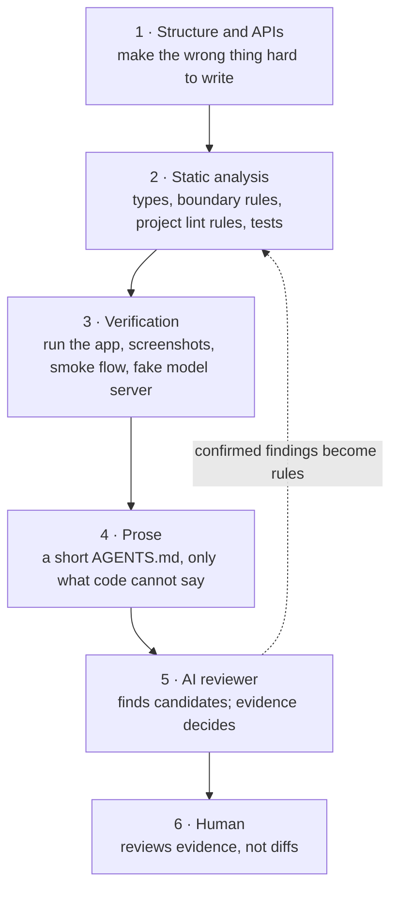

<div align="center">

# Trust Pyramid

**Stop reviewing AI-written code line by line. Make your coding agent prove its work.**

An agent skill for **Claude Code** and **Codex** that sets up a project-specific quality system:
architecture constraints, lint rules whose error messages tell the agent how to fix the code,
runtime verification in the real app, an evidence-based AI reviewer, and gates the agent cannot skip.

[](https://github.com/Tim-rppl/trust-pyramid/actions/workflows/ci.yml)


**English** · [简体中文](README.zh-CN.md)

</div>

---

## Why

Coding agents write code faster than anyone can review it. Writing more rules into `AGENTS.md`
does not fix this: prose is advice, and agents skip advice, on purpose or not.

Trust Pyramid moves trust from people to the system:

- **Rules live in code, not prose.** A mistake corrected once becomes a lint rule or a test, so it
  cannot happen again - for any agent or any person.
- **Error messages are prompts.** Every rule says what is wrong and how to fix it, so the agent
  repairs its own code without you.
- **Behavior is proven, not claimed.** The agent runs the real app, clicks through it, takes
  screenshots, and runs a smoke flow.
- **Checks cannot be skipped.** They run in the agent's Stop hook, in pre-commit, and in CI with
  branch protection - triggered by the system, never by the agent being checked.
- **An AI reviewer fills the gap while rules are few.** Its findings only count with evidence: a
  test that fails on the old code and passes on the new code. Confirmed findings become new rules.

The approach follows Lauren Tan's talk
[*All Code Is Slop (Except Mine)*](https://www.youtube.com/watch?v=O_zcc6Xl12g) (AI Engineer Code
Summit 2026) and adds the enforced reviewer layer.

## How it works



Higher layers are cheaper and deterministic, so the skill always tries them first.
The gates make sure every layer actually runs:

| When | Gate | Can the agent skip it? |
|---|---|---|
| Agent tries to finish | Stop hook (Claude Code and Codex, one script) | Hard - it is told to keep fixing |
| `git commit` | pre-commit hook | Only with `--no-verify` |
| Pull request | CI: checks, smoke, AI review, review gate | **No** - with branch protection |
| Merge | Your approval, based on evidence | It is your call |

## Quick start

### Claude Code

Install as a plugin:

```text
/plugin marketplace add Tim-rppl/trust-pyramid
/plugin install trust-pyramid@trust-pyramid
```

Or copy the skill manually:

```bash
git clone https://github.com/Tim-rppl/trust-pyramid.git
cp -R trust-pyramid/skills/trust-pyramid ~/.claude/skills/
```

Use one method, not both, or the skill will be listed twice.

### Codex

```bash
git clone https://github.com/Tim-rppl/trust-pyramid.git
mkdir -p ~/.agents/skills && cp -R trust-pyramid/skills/trust-pyramid ~/.agents/skills/
```

For a single repository, copy it to `.agents/skills/trust-pyramid` in that repository instead.

### Run it

Open your project, switch to plan mode if your agent has one, and ask:

```text
Use the trust-pyramid skill to set up quality gates for this project.
Product: a real-time transcription + translation web app.
Stack: TypeScript, React (Vite), Node.js, Firebase, OpenAI-compatible model APIs.
UI: English and Chinese. I can't judge code well; show me evidence in plain language.
```

In Codex you can also type `$trust-pyramid`.

The agent interviews you briefly, writes a plan, **waits for your approval**, then builds the
layers one by one. At the end it proves every check can fail, runs a demo loop on a small
feature, and reports in plain language.

## What you get

| Area | Files added to your project |
|---|---|
| Gates | `scripts/check.sh`, `scripts/stop-gate.sh`, `.githooks/pre-commit`, `.claude/settings.json`, `.codex/hooks.json` |
| Lint | `lint/` - a project plugin with fix-it messages, fixtures, and a test that proves each rule fires |
| Verification | `verify/app.mjs` (up/click/fill/snapshot/screenshot/errors), `verify/smoke.mjs`, `verify/feature-map.md`, `verify/fake-openai.mjs` |
| AI reviewer | `quality/reviewer-prompt.md`, `.claude/agents/quality-reviewer.md`, `scripts/review-gate.mjs`, `quality/review-dispositions.json` |
| Ratchet ledger | `quality/rule-candidates.md`, `quality/review-log.md` |
| CI | `.github/workflows/quality.yml`, `.github/pull_request_template.md` |
| Prose | a short `AGENTS.md` (and `CLAUDE.md` → `@AGENTS.md`), `docs/QUALITY.md` |

Everything is adapted to your stack. Recipes are included for TypeScript/React/Node/Firebase,
Next.js + Postgres, Python/FastAPI (field-tested, with an AST rule template), Go, and mobile.

## The enforced AI reviewer

An AI reviewer is useful early, when there are few rules and you cannot spot problems yourself.
It is also easy to skip or to wave away. Trust Pyramid closes both holes:

1. **It always runs.** CI reviews every pull request (Claude Code or Codex action), cached by a
   hash of the code diff so it reruns only when code changes.
2. **Every finding needs an answer.** `quality/review-dispositions.json` marks each finding
   `confirmed`, `rejected` or `deferred`. `scripts/review-gate.mjs` is a required check:
   - **confirmed** → the named test must **fail on the base commit (at an assertion, not an import
     error) and pass on the PR head**, checked by machine;
   - **rejected** → not a real problem; needs a concrete reason, shown to you in the PR;
   - **deferred** → real but not fixed now; needs a reason and must be recorded in
     `quality/rule-candidates.md`, so it is tracked rather than forgotten.
3. **Confirmed findings feed the ratchet.** Each becomes a lint rule, a test, or an entry in
   `quality/rule-candidates.md`; the second occurrence must become a rule.

## Daily use

```text
# A mistake happened again
Turn this into a rule using trust-pyramid's add-rule process: <describe the mistake>.

# Before a pull request
Run the quality reviewer on this branch, prove or reject each finding, and give me a plain-language summary.

# Weekly
Sweep the whole repo with the reviewer and update quality/rule-candidates.md with the top 3 rule candidates.
```

## FAQ

**Is this just a code-review skill?** No. The reviewer is one layer. Most of the value comes from
rules in code and gates that run without asking the agent.

**Does it work for existing projects?** Yes. It locks in what is already clean and ratchets the
rest: noisy rules start on new code only, with a recorded backlog.

**Do I need GitHub?** The local gates work anywhere. The unskippable layer needs CI with branch
protection; the templates target GitHub Actions.

**What does it cost?** Linting and tests are free. The AI review runs once per code change in CI
and uses your Anthropic or OpenAI API key.

## Repository layout

```text
skills/trust-pyramid/
├── SKILL.md            # the workflow the agent follows
├── agents/openai.yaml  # Codex UI metadata
├── references/         # one file per layer, gates, stack recipes, lessons learned
└── templates/          # files the agent installs and adapts
.claude-plugin/         # Claude Code plugin + marketplace manifests
tests/                  # tests for the templates themselves
```

## Contributing

Issues and pull requests are welcome, especially stack recipes and lessons learned.
See [CONTRIBUTING.md](CONTRIBUTING.md). Run `npm ci && npm test` before opening a PR.

## Credits

- Lauren Tan, [*All Code Is Slop (Except Mine)*](https://ai.engineer/code/2026/talks/lauren-tan), AI Engineer Code Summit 2026.
- OpenAI, [*Harness engineering*](https://openai.com/index/harness-engineering/).
- Maddila et al., [*Agentic Program Repair from Test Failures at Scale*](https://arxiv.org/abs/2507.18755).

## License

[MIT](LICENSE)
