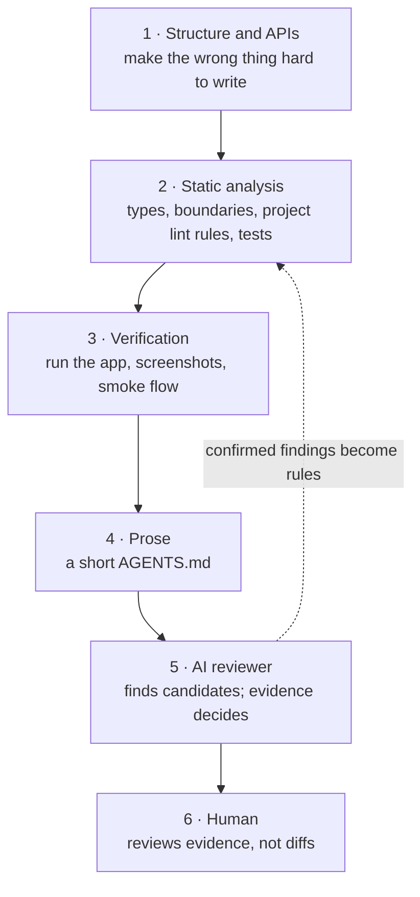

<div align="center">

# Trust Pyramid

**Make your coding agent prove its work, so you don't have to review every line.**

[](https://github.com/Tim-rppl/trust-pyramid/actions/workflows/ci.yml)


**English** · [简体中文](README.zh-CN.md)


<sub>Terminal output and screenshots are real, from a demo project. The agent's edits are replayed by a script.</sub>

</div>

Trust Pyramid is an agent skill for Claude Code and Codex. Run it once in a repository and it sets
up project-specific lint rules, runtime checks, an AI reviewer, and gates that check every change
the agent makes.

## Background

Trust Pyramid implements the inverted trust pyramid that Lauren Tan, Principal Engineer at
SpaceXSI, presented on the main stage of [AI Engineer Code Summit 2026](https://ai.engineer/code/2026/talks/lauren-tan) in
[*All Code Is Slop (Except Mine)*](https://www.youtube.com/watch?v=O_zcc6Xl12g). The talk draws on shipping thousands of
agent-written pull requests. Its central point: when an agent repeats a mistake, the correction
belongs in the codebase, an API, or an executable check, not in another line of `AGENTS.md`.

The project also draws on OpenAI's [*Harness engineering*](https://openai.com/index/harness-engineering/)
and a production study of agents fixing test failures at scale
([Maddila et al., 2025](https://arxiv.org/abs/2507.18755)). Trust Pyramid adds an enforced AI
reviewer layer and packages the method as an installable skill. It is an independent project, not
affiliated with Lauren Tan, SpaceXSI or Cursor.

## Highlights

- **Rules live in code, not in prompts.** A mistake you correct once becomes a lint rule or a test,
  so it stays fixed for every agent and every person.
- **Error messages say how to fix the problem.** The agent repairs its own code from the lint output.
- **Checks run without asking the agent.** They run when the agent stops, on commit, and in CI. CI
  uses the base branch's rules, so a pull request cannot loosen the rules it is checked by.
- **The AI reviewer needs proof.** A finding counts only with a test that fails before the fix and
  passes after it.
- **Light by default.** Most checks are ordinary scripts and use no model tokens.

## Install

**Claude Code**, as a plugin:

```text
/plugin marketplace add Tim-rppl/trust-pyramid
/plugin install trust-pyramid@trust-pyramid
```

**Codex**:

```bash
git clone https://github.com/Tim-rppl/trust-pyramid.git
mkdir -p ~/.agents/skills && cp -R trust-pyramid/skills/trust-pyramid ~/.agents/skills/
```

To install for one repository only, copy it to `.agents/skills/trust-pyramid` in that repository.
Claude Code users who prefer not to use plugins can copy the same folder to `~/.claude/skills/`.

## Usage

1. Open your project (in plan mode, if your agent has one) and ask:

   ```text
   Use the trust-pyramid skill to set up quality gates for this project.
   Product: a note-taking web app. Stack: TypeScript, React, Node.js, Postgres.
   ```

   In Codex you can also type `$trust-pyramid`.

2. Answer a few questions and approve the plan. Nothing changes before you approve.

3. Enable the hooks. Agents cannot change their own hook settings, so run this once per clone:

   ```bash
   bash scripts/install-agent-hooks.sh
   ```

   It shows each change and asks first. `bash scripts/hook-status.sh` shows what is enabled.

4. Start a new agent session and work as usual. When the agent tries to finish, the checks run; if
   they fail, it keeps fixing.

At the end of setup the agent shows that every check can fail, runs one feature through the whole
loop, and reports the results in plain language.

## How it works



Higher layers are cheaper and give the same answer every time, so the skill uses them first. Gates
make sure each layer runs:

| When | Gate | Can it be skipped? |
|---|---|---|
| The agent tries to finish | Stop hook | It is fast feedback; local hooks can be switched off |
| `git commit` | pre-commit | Only with `--no-verify` |
| Pull request | CI, using the base branch's gate files | No, with branch protection |
| Merge | You, reading the evidence | Your call |

## Should you use it?

**It pays off** for long-lived repositories, projects with rules a model cannot know, smaller or
cheaper models, many contributors, and owners who cannot review code themselves.

**It probably doesn't** for prototypes, throwaway code, or a frontier model making small changes
you can check yourself. In our benchmark, Claude Opus 5.5 with no tooling already handled the
single-task traps, and running the full pyramid on every task cost about 4x without catching more.
That is why the default profile is lite.

**Cost.** Checks are scripts and free. Setup took 24-32 min on a mid-size app: ~$6.5 with Claude
Code, ~8.5M tokens with Codex. The CI reviewer costs about $0.7 per small pull request. See
[cost and limits](docs/GUIDE.md#cost-and-limits) and the [benchmark](docs/BENCHMARK.md).

## Documentation

- [Guide](docs/GUIDE.md): profiles, files added to your project, the AI reviewer, daily use, cost and limits
- [Benchmark](docs/BENCHMARK.md): what we measured and how
- [SKILL.md](skills/trust-pyramid/SKILL.md): the workflow the agent follows, with one
  [reference](skills/trust-pyramid/references/) per layer

## FAQ

**Is this a code review skill?** No. The reviewer is one layer. Most of the value comes from rules
in code and gates that run on their own.

**Does it work on existing projects?** Yes. It locks in what is already clean; noisy rules start on
new code only, with the backlog recorded.

**Do I need GitHub?** The local gates work anywhere. The gate that cannot be skipped needs CI with
branch protection; the templates target GitHub Actions.

## Related

Lauren Tan's own skills are published as [pstack](https://github.com/cursor/plugins/tree/main/pstack).
They shape how the agent writes code, while Trust Pyramid checks the result. pstack is not required.

## Contributing

Issues and pull requests are welcome, especially stack recipes and lessons from real projects. See
[CONTRIBUTING.md](CONTRIBUTING.md).

## Acknowledgements

- Lauren Tan, [*All Code Is Slop (Except Mine)*](https://ai.engineer/code/2026/talks/lauren-tan), AI Engineer Code Summit 2026
- OpenAI, [*Harness engineering*](https://openai.com/index/harness-engineering/)
- Maddila et al., [*Agentic Program Repair from Test Failures at Scale*](https://arxiv.org/abs/2507.18755)

## License

[MIT](LICENSE)
