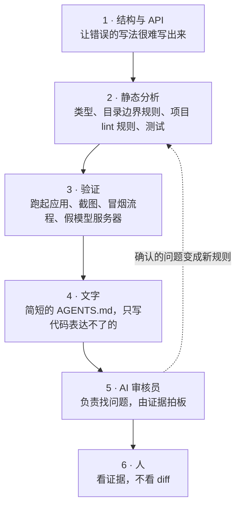

<div align="center">

# Trust Pyramid 信任金字塔

**别再逐行审 AI 写的代码了，让编码 agent 自己证明它是对的。**

一个同时支持 **Claude Code** 和 **Codex** 的 agent skill，为你的项目搭建一套量身定制的质量体系：
架构约束、报错里直接写着改法的 lint 规则、在真实应用里的运行时验证、以证据说话的 AI 审核员，
以及 agent 无法跳过的关卡。

[](https://github.com/Tim-rppl/trust-pyramid/actions/workflows/ci.yml)


[English](README.md) · **简体中文**


<sub>终端输出和应用截图都是从一个演示项目里真实录下的。agent 的修改由脚本重放；审核发现来自一次真实的、独立的 AI 审核。</sub>

</div>

---

## 为什么需要它

编码 agent 写代码的速度，已经远远超过人能审的速度。往 `AGENTS.md` 里多写几条规定解决不了问题：
文字只是建议，agent 可能有意或无意地跳过。

信任金字塔把"信任"从人身上挪到系统里：

- **规矩写进代码，而不是写成文字。** 纠正过一次的错误会变成 lint 规则或测试，以后无论哪个 agent、
  哪个人都不会再犯。
- **报错就是提示词。** 每条规则都写清错在哪、怎么改，agent 不用你教就能自己修好。
- **行为要证明，不能只是声称。** agent 会把应用真正跑起来，像用户一样点击、截图，并跑完冒烟流程。
- **检查无法跳过。** 检查在 agent 的 Stop hook、pre-commit、带分支保护的 CI 里运行，由系统触发，
  而不是由被检查的 agent 自己决定。
- **规则还少的时候，用 AI 审核员补位。** 它的发现必须有证据才算数：一个在旧代码上失败、
  在新代码上通过的测试。确认的问题会变成新规则。

这套方法来自 Lauren Tan 的演讲
[《All Code Is Slop (Except Mine)》](https://www.youtube.com/watch?v=O_zcc6Xl12g)（AI Engineer Code Summit 2026），
并在此基础上加上了"强制执行的 AI 审核员"这一层。她本人也开源了自己的 skill 集合
[pstack](https://github.com/cursor/plugins/tree/main/pstack)，两者的区别和搭配方式见[搭配 pstack 使用](#搭配-pstack-使用可选)。

## 原理



越靠上的层越便宜、越确定，所以 skill 总是优先用上层解决问题。
下面这些关卡保证每一层都真的会运行：

| 时机 | 关卡 | agent 能跳过吗？ |
|---|---|---|
| agent 想结束任务 | Stop hook（Claude Code 和 Codex 共用一个脚本） | 很难，但 agent 能改本地 hook 文件，所以它负责快速反馈，不是最终保证 |
| `git commit` | pre-commit hook | 只能用 `--no-verify` 绕过 |
| 开 PR | CI：检查、冒烟、AI 审核、审核关卡，**使用主分支上的关卡文件** | **不能**，配合分支保护和代码负责人审批 |
| 合并 | 你根据证据批准 | 由你决定 |

## 实测结果

在推荐之前，我们用真实的 Claude Code 和 Codex 测试过 Trust Pyramid（[完整报告，英文](docs/BENCHMARK.md)）。简单说：

- **项目专属规则有效。** 目录边界、"这里绝不能做某事"这类规则，每次都拦住了埋入的错误；审核发现的问题变成测试后，同类错误不会再出现。
- **最初的关卡设计能被绕过**（在 PR 里直接关掉规则）。现在 CI 用主分支上的关卡文件检查每个 PR，7 种绕过方式全部被拦住。
- **当前最强的模型单次任务已经做得很好。** 不装任何工具的 Claude Opus 5.5 就能处理并发竞争、修改丢失和跨功能不变量。每个任务都跑完整流程，成本约 4 倍，却没有多抓到问题。所以默认采用**轻量模式**。

## 两种模式

| | 轻量模式（默认） | 完整模式 |
|---|---|---|
| 项目 lint 规则、目录边界、测试 | 有 | 有，另加属性测试 |
| 可信 CI、代码负责人审批、pre-commit | 有 | 有 |
| Stop hook | 只跑快速检查，最多拦 2 次 | 同左 |
| AI 审核员 | 每个 PR 在 CI 里跑一次 | 每个任务后也跑 |
| 运行时验证 | 冒烟流程在 CI 里跑 | 每次改动用户可见的功能都跑 |

以下情况建议用**完整模式**：编码 agent 用的是较小或较便宜的模型、参与的人或 agent 很多、代码涉及钱、权限或个人数据。随时可以切换。

## 成本与限制

**用量花在哪里。** 金字塔的大部分都是普通脚本，完全不消耗模型用量。

| 环节 | 消耗 token 吗 | 实测 / 预估 |
|---|---|---|
| agent 一次性搭建 | 是 | 25–30 分钟；在中等规模的 Remix 项目上，Claude 约 $6.5，Codex 约 850 万 token |
| lint、类型检查、测试、Stop hook、pre-commit、可信 CI | **否**，都是脚本 | 免费 |
| 关卡拦下后，agent 修复 | 是 | 代码本来就对时为 0；否则多一两轮（Stop hook 最多拦 2 次） |
| AI 审核员，每个 PR 在 CI 里跑一次 | 是 | 小改动约 $0.7；有发现时还要加上 agent 处理的用量 |
| `AGENTS.md` 和规则说明 | 少量 | 每次对话多读十几行 |

在实测中，接近完整模式的配置（每个任务后都审核、Stop hook 最多拦 3 次）每个任务的成本约为基线的 4 倍。轻量模式去掉了这两项开销，但**轻量模式本身还没有实测过**，上表中它的数字是估算值。

**什么时候不值得用。** 个人小项目、原型、很快会扔掉的代码，或者用最强的模型做你自己也能把关的小改动。实测中，这种情况下单次任务的质量没有提升。

**什么时候值得用。** 长期维护的项目（规则写一次、之后永久免费运行）、有模型不可能知道的项目专属规矩、需要防止回归、用较小或较便宜的模型、参与的人很多，以及项目负责人看不懂代码、却需要能信任的 agent。

**已知限制。**
- 本地关卡（Stop hook、pre-commit）是快速反馈，不是保证：agent 可以修改它们。只有可信 CI 加上分支保护和代码负责人审批，才是真正跳不过的。
- agent 装不了自己的 hook 配置，需要你运行一次 `scripts/install-agent-hooks.sh`。
- AI 审核员不稳定（实测 10 次里漏了 1 次埋入的问题）。它的发现必须有证据才算数，确认的问题应该变成规则或测试。
- Codex 的沙箱禁止启动浏览器，所以在 Codex 下冒烟流程放在 CI 里跑。
- 实测规模很小（每组只跑一次）。详见 [docs/BENCHMARK.md](docs/BENCHMARK.md)（英文）。

想尽量省用量：先只装 lint 规则、测试和可信 CI；需要时再开启每个 PR 的审核员，或者只对高风险的 PR 开启；用几周后看看 `quality/review-log.md`，如果审核员没发现过真问题，就把它关掉。

## 快速开始

### Claude Code

作为插件安装：

```text
/plugin marketplace add Tim-rppl/trust-pyramid
/plugin install trust-pyramid@trust-pyramid
```

或者手动复制：

```bash
git clone https://github.com/Tim-rppl/trust-pyramid.git
cp -R trust-pyramid/skills/trust-pyramid ~/.claude/skills/
```

两种方式选一种即可，同时使用会让 skill 出现两次。

### Codex

```bash
git clone https://github.com/Tim-rppl/trust-pyramid.git
mkdir -p ~/.agents/skills && cp -R trust-pyramid/skills/trust-pyramid ~/.agents/skills/
```

如果只想在某一个仓库里用，就复制到那个仓库的 `.agents/skills/trust-pyramid`。

### 开始使用

打开你的项目（如果 agent 有计划模式，先切过去），然后说：

```text
用 trust-pyramid skill 给这个项目搭建质量关卡。
产品：实时转写 + 翻译的网页应用。
技术栈：TypeScript、React（Vite）、Node.js、Firebase、OpenAI 兼容格式的模型 API。
界面：中英双语。我不太会判断代码好坏，请用大白话和证据向我汇报。
```

在 Codex 里也可以直接输入 `$trust-pyramid`。

agent 会先简单问你几个问题，写一份计划，**等你确认后**再逐层搭建。最后它会证明每一项检查都
真的会报错，用一个小功能完整演示一遍循环，并用大白话向你汇报。

## 搭配 pstack 使用（可选）

Lauren Tan 本人也开源了她的 skill 集合
[**pstack**](https://github.com/cursor/plugins/tree/main/pstack)（MIT 许可证）。它和本项目是两个不同的工具，
各自解决问题的一半，可以一起使用。在我们的实测中，用当前最强的模型做单次任务时，pstack 没有改变结果，用量却更多，所以请把它当作一种工作方式的选择，而不是质量上的必需品。

| | pstack | Trust Pyramid |
|---|---|---|
| 是什么 | 约 60 个 skill，改变 **agent 的工作方式**：`/poteto-mode` 内置 22 个场景流程（修 bug、性能、重构、新功能……）、一套工程原则，以及 `/correct`、`/create-verification-skill` 等"造检查"的工具 | 一个 skill，**把强制执行的检查装进你的项目**：lint 规则、验证工具、强制 AI 审核、各道关卡 |
| 什么时候起作用 | agent 写代码的过程中，你调用它的时候 | agent 收工、你提交、开 PR 时，自动起作用 |
| 装完能不能马上用 | 能 | 要先跑一次搭建（出计划、你确认、安装） |
| 能不能被跳过 | 能，它的 skill 只有在你调用时才运行 | 不能，关卡运行不需要 agent 同意 |
| 卸载之后 | 效果随之消失 | 规则和关卡留在项目里，继续生效 |

**为什么两个都装：** pstack 让 agent 一开始就做对，少返工；Trust Pyramid 保证它仍然做错的部分进不了
`main`。pstack 还提供了 Trust Pyramid 只简单提到的能力：命令行、桌面端、移动端应用的验证，状态图，
以及形式化验证。pstack 是 Lauren Tan 的项目；Trust Pyramid 是独立项目，与她本人和 Cursor 没有关联。

### 安装两者

Claude Code：

```text
/plugin marketplace add cursor/plugins
/plugin install pstack@cursor-plugins
/plugin marketplace add Tim-rppl/trust-pyramid
/plugin install trust-pyramid@trust-pyramid
```

然后运行一次 `/pstack:setup-pstack`，选择要用的模型和推理强度。

Codex（以及其他 agent）：通过 pstack 的官方同步镜像和 `skills` 命令行安装：

```bash
npx skills add backnotprop/pstack
```

Trust Pyramid 的安装方法见[快速开始](#codex)。

### 在对话框里怎么一起用

在 Claude Code 里，pstack 的命令要带插件前缀（`/pstack:<skill>`）。在 Codex 里，用 `$<skill>` 调用
（例如 `$poteto-mode`）。

**1. 每个项目做一次：搭好关卡。**

```text
用 trust-pyramid skill 给这个项目搭建质量关卡。<产品、技术栈、界面语言>
```

**2. 每个任务：用 pstack 干活，让关卡把关。**

```text
/pstack:poteto-mode 给笔记页加一个导出 CSV 的功能，并在运行中的应用里验证。
```

pstack 负责把活干好；agent 想收工时，Trust Pyramid 的 Stop hook 会自动跑检查，有问题就打回去继续修。

**3. 同一个错误出现第二次：让它永远不再发生。**

```text
/pstack:correct agent 总是在路由处理函数里直接调用模型 API。
```

`/correct` 会把这个错误变成架构约束、类型、lint 规则或测试，并证明它在旧代码上会报错。新规则之后会在
每一道关卡里自动运行。

**4. 你的应用不是网页（命令行、桌面端、移动端）：生成它的验证工具。**

```text
/pstack:create-verification-skill
```

Trust Pyramid 流程里需要运行时验证的地方，就用它生成的这个 skill。

**5. 开 PR 之前：让审核员找问题，把有价值的留下来。**

```text
用 quality reviewer 审一遍当前分支。对每个确认的问题，用 /pstack:correct 把它变成规则，
再把处理结论记到 quality/review-dispositions.json。
```

**6. 可选：状态复杂的功能（录音会话、订阅、重试）：**

```text
/pstack:statechart 录音会话
/pstack:create-formal-verification-skill
```

| 你想要…… | 用 |
|---|---|
| 严谨地完成一个任务 | `/pstack:poteto-mode` |
| 让一个反复出现的错误永远不再发生 | `/pstack:correct`（或 Trust Pyramid 的 add-rule 流程） |
| 证明非网页应用的行为正确 | `/pstack:create-verification-skill` |
| 删掉替临时补丁辩解的注释 | `/pstack:no-comments` |
| 确保有问题的代码合并不了 | Trust Pyramid 的关卡（自动） |
| 让 AI 帮你找出问题 | Trust Pyramid 的审核员（每个 PR 自动运行） |

## 你会得到什么

| 方面 | 加到项目里的文件 |
|---|---|
| 关卡 | `scripts/check.sh`、`scripts/stop-gate.sh`、`.githooks/pre-commit`、`.claude/settings.json`、`.codex/hooks.json` |
| Lint | `lint/`：项目专用插件（报错附改法）、违规和合规样例、证明每条规则会触发的测试 |
| 验证 | `verify/app.mjs`（up/click/fill/snapshot/screenshot/errors）、`verify/smoke.mjs`、`verify/feature-map.md`、`verify/fake-openai.mjs` |
| AI 审核员 | `quality/reviewer-prompt.md`、`.claude/agents/quality-reviewer.md`、`scripts/review-gate.mjs`、`quality/review-dispositions.json` |
| 复利台账 | `quality/rule-candidates.md`、`quality/review-log.md` |
| CI | `.github/workflows/quality.yml`、`.github/pull_request_template.md` |
| 文字 | 简短的 `AGENTS.md`（`CLAUDE.md` 里写 `@AGENTS.md`）、`docs/QUALITY.md` |

所有内容都会按你的技术栈调整。内置了 TypeScript/React/Node/Firebase、Next.js + Postgres、
Python/FastAPI（经过实测，附 AST 规则模板）、Go、移动端的参考方案。

## 强制执行的 AI 审核员

在规则还少、你自己又看不出问题的阶段，AI 审核员很有用。但它也很容易被跳过，或者发现的问题被
随手打发掉。信任金字塔把这两个漏洞都堵上了：

1. **它一定会运行。** CI 会审每一个 PR（用 Claude Code 或 Codex 的 GitHub Action），并按代码 diff
   的哈希缓存，只有代码变了才重新审。
2. **每个发现都必须有交代。** `quality/review-dispositions.json` 把每条发现标为 `confirmed`（确认）、
   `rejected`（否决）或 `deferred`（暂缓）。`scripts/review-gate.mjs` 是合并的必要检查：
   - **确认**：指定的测试必须**在改动前的代码上失败（失败在断言上，而不是导入报错）、在 PR 的代码上通过**，
     由机器核对；
   - **否决**：不是真问题，必须写出具体理由，并在 PR 里展示给你；
   - **暂缓**：是真问题但这次不修，必须写理由，并登记到 `quality/rule-candidates.md`，确保被跟踪而不是被遗忘。
3. **确认的问题进入复利循环。** 每一条都会变成 lint 规则、测试，或记入 `quality/rule-candidates.md`；
   同类问题第二次出现时必须变成规则。

## 日常使用

```text
# 同样的错误又出现了
按 trust-pyramid 的 add-rule 流程，把这个问题变成规则：<描述问题>。

# 开 PR 之前
用 quality reviewer 审一遍当前分支，逐条证明或否决，然后给我一份大白话总结。

# 每周一次
用审核员巡检整个仓库，更新 quality/rule-candidates.md，列出最值得变成规则的 3 条。
```

## 常见问题

**这只是一个代码审核 skill 吗？** 不是。审核员只是其中一层，大部分价值来自写进代码的规则，
以及不需要征得 agent 同意就会运行的关卡。

**已有项目能用吗？** 能。它会先锁住已经干净的部分，其余的逐步收紧：违规太多的规则先只管新代码，
并记录待清理的存量。

**一定要用 GitHub 吗？** 本地关卡在哪里都能用。"无法跳过"这一层需要带分支保护的 CI，模板是为
GitHub Actions 写的。

**要花多少钱？** 各项检查都是脚本，不花钱；一次性搭建和每个 PR 的 AI 审核会消耗模型用量（CI 里用你自己的 Anthropic 或 OpenAI API key）。详见[成本与限制](#成本与限制)。

## 仓库结构

```text
skills/trust-pyramid/
├── SKILL.md            # agent 遵循的工作流程
├── agents/openai.yaml  # Codex 界面元数据
├── references/         # 每层一份文档、关卡、技术栈方案、实践经验
└── templates/          # agent 会安装并调整的文件
.claude-plugin/         # Claude Code 插件和 marketplace 清单
tests/                  # 模板本身的测试
```

## 参与贡献

欢迎提 issue 和 PR，尤其是新的技术栈方案和实践经验。详见 [CONTRIBUTING.md](CONTRIBUTING.md)。
提 PR 前请运行 `npm ci && npm test`。

## 致谢

- Lauren Tan，[《All Code Is Slop (Except Mine)》](https://ai.engineer/code/2026/talks/lauren-tan)，AI Engineer Code Summit 2026。
- Lauren Tan，[pstack](https://github.com/cursor/plugins/tree/main/pstack)（MIT），演讲背后的 skill 集合。
- OpenAI，[《Harness engineering》](https://openai.com/index/harness-engineering/)。
- Maddila 等，[《Agentic Program Repair from Test Failures at Scale》](https://arxiv.org/abs/2507.18755)。

## 许可证

[MIT](LICENSE)
