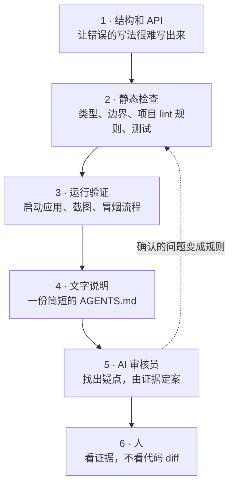

<div align="center">

# Trust Pyramid

**让编程 agent 自己证明代码没问题，你不用再逐行审代码。**

[](https://github.com/Tim-rppl/trust-pyramid/actions/workflows/ci.yml)


[English](README.md) · **简体中文**


<sub>终端输出和截图都是真实的，来自一个演示项目；agent 的编辑过程由脚本回放。</sub>

</div>

Trust Pyramid 是一个给 Claude Code 和 Codex 用的 agent skill。在仓库里运行一次，它会为项目搭好专属的
lint 规则、运行时检查、AI 审核员，以及检查 agent 每一次改动的关卡。

## 特点

- **规则写在代码里，不写在提示词里。** 纠正过一次的错误会变成 lint 规则或测试，之后不管哪个 agent、哪个人都不会再犯。
- **报错信息直接写明怎么修。** agent 看着 lint 输出就能自己改好。
- **检查不由 agent 决定跑不跑。** agent 结束时、commit 时、CI 里都会自动检查。CI 用主分支上的规则，PR 改不了检查自己的规则。
- **AI 审核员的发现要拿证据说话。** 只有修复前失败、修复后通过的测试，才能证明问题成立。
- **默认是轻量模式。** 大部分检查是普通脚本，不消耗模型 token。

## 安装

**Claude Code**，作为插件安装：

```text
/plugin marketplace add Tim-rppl/trust-pyramid
/plugin install trust-pyramid@trust-pyramid
```

**Codex**：

```bash
git clone https://github.com/Tim-rppl/trust-pyramid.git
mkdir -p ~/.agents/skills && cp -R trust-pyramid/skills/trust-pyramid ~/.agents/skills/
```

只给某一个仓库用的话，复制到该仓库的 `.agents/skills/trust-pyramid`。Claude Code 用户如果不想用插件，也可以把同一个文件夹复制到 `~/.claude/skills/`。

## 使用

1. 打开你的项目（agent 有计划模式的话先切过去），然后说：

   ```text
   Use the trust-pyramid skill to set up quality gates for this project.
   Product: a note-taking web app. Stack: TypeScript, React, Node.js, Postgres.
   ```

   用中文描述也可以。在 Codex 里也可以输入 `$trust-pyramid`。

2. 回答几个问题，确认计划。你确认之前，它不会改任何东西。

3. 启用 hook。agent 改不了自己的 hook 设置，所以每个克隆需要你运行一次：

   ```bash
   bash scripts/install-agent-hooks.sh
   ```

   它会先列出每项改动并询问你。`bash scripts/hook-status.sh` 可以查看哪些已经启用。

4. 开一个新的 agent 会话，照常工作。agent 想结束时会自动跑检查，没通过就继续修。

搭建结束时，agent 会证明每一项检查确实能拦住错误，用一个小功能走完整个流程，再用大白话汇报结果。

## 工作原理



越靠上的层越便宜，而且每次结果都一样，所以 skill 优先用它们。下面这些关卡保证每一层都真的会跑：

| 时机 | 关卡 | 能跳过吗 |
|---|---|---|
| agent 想结束这一轮 | Stop hook | 它是快速反馈；本地 hook 可以被关掉 |
| `git commit` | pre-commit | 只能用 `--no-verify` 跳过 |
| 提 PR | CI，使用主分支上的关卡文件 | 开启分支保护后跳不过 |
| 合并 | 你，看证据决定 | 由你决定 |

## 适合你吗

**值得用：** 长期维护的仓库、有模型不可能知道的项目规矩、用较小或较便宜的模型、参与的人多，或者项目负责人自己审不了代码。

**可能不值得：** 原型、用完就扔的代码，或者用最强的模型做你自己能把关的小改动。实测中，不加任何工具的 Claude Opus 5.5 已经能处理单个任务里的陷阱；每个任务都跑完整金字塔，成本约为 4 倍，却没有多发现问题。所以默认是轻量模式。

**成本：** 检查都是脚本，免费。在一个中等规模的应用上，搭建用了 24-32 分钟：Claude Code 约 $6.5，Codex 约 850 万 token。CI 里的审核员每个小 PR 约 $0.7。详见[成本和限制](docs/GUIDE.md#cost-and-limits)（英文）和[实测报告](docs/BENCHMARK.md)（英文）。

## 文档

- [使用指南](docs/GUIDE.md)（英文）：两种模式、会加到项目里的文件、AI 审核员、日常用法、成本和限制
- [实测报告](docs/BENCHMARK.md)（英文）：测了什么、怎么测的
- [SKILL.md](skills/trust-pyramid/SKILL.md)（英文）：agent 遵循的流程，每一层都有对应的[参考文档](skills/trust-pyramid/references/)

## 常见问题

**这是个代码审核 skill 吗？** 不是。审核员只是其中一层，主要的价值来自写在代码里的规则，以及自动运行的关卡。

**老项目能用吗？** 能。已经干净的部分会被锁定；会大量报错的规则先只管新代码，存量问题记录在案。

**必须用 GitHub 吗？** 本地关卡在哪里都能用。跳不过的那一关需要 CI 加分支保护，模板是按 GitHub Actions 写的。

## 相关项目

这套方法来自 Lauren Tan 的演讲 [*All Code Is Slop (Except Mine)*](https://www.youtube.com/watch?v=O_zcc6Xl12g)，并加上了强制执行的审核员层。她本人的 skill 以 [pstack](https://github.com/cursor/plugins/tree/main/pstack) 的名字开源：pstack 影响 agent 怎么写代码，Trust Pyramid 负责检查写出来的结果。使用 Trust Pyramid 不需要安装 pstack；本项目与她本人及 Cursor 没有关联。

## 参与贡献

欢迎提 issue 和 PR，尤其是新技术栈的配置方案和真实项目里的经验。详见 [CONTRIBUTING.md](CONTRIBUTING.md)（英文）。

## 致谢

- Lauren Tan，[*All Code Is Slop (Except Mine)*](https://ai.engineer/code/2026/talks/lauren-tan)，AI Engineer Code Summit 2026
- OpenAI，[*Harness engineering*](https://openai.com/index/harness-engineering/)
- Maddila 等，[*Agentic Program Repair from Test Failures at Scale*](https://arxiv.org/abs/2507.18755)

## 许可证

[MIT](LICENSE)
