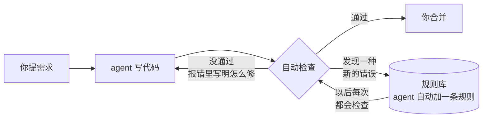

<div align="center">

# Trust Pyramid

**让编程 agent 自己证明代码没问题，你不用再逐行审代码。**

[](https://github.com/Tim-rppl/trust-pyramid/actions/workflows/ci.yml)


[English](README.md) · **简体中文**


<sub>终端输出和截图都是真实的，来自一个演示项目；agent 的编辑过程由脚本回放。</sub>

</div>

Trust Pyramid 是一个给 Claude Code 和 Codex 用的 agent skill。在仓库里运行一次，它会为项目搭好专属的
lint 规则、运行时检查、AI 审核员，以及检查 agent 每一次改动的关卡。

## 背景

Trust Pyramid 实现的是“倒置信任金字塔”方法。它来自 SpaceXSI 首席工程师 Lauren Tan 在
[AI Engineer Code Summit 2026](https://ai.engineer/code/2026/talks/lauren-tan) 主会场的演讲
[*All Code Is Slop (Except Mine)*](https://www.youtube.com/watch?v=O_zcc6Xl12g)，演讲内容基于她用 agent 交付数千个 PR 的实践。
核心观点是：agent 重复犯的错，应该在代码、API 或可执行的检查里纠正，而不是往 `AGENTS.md` 里再加一句提醒。

本项目还参考了 OpenAI 的 [*Harness engineering*](https://openai.com/index/harness-engineering/)，
以及一项关于 agent 在生产环境中大规模修复测试失败的研究（[Maddila 等，2025](https://arxiv.org/abs/2507.18755)）。
在此基础上，Trust Pyramid 增加了强制执行的 AI 审核员层，并把整套方法做成可以直接安装的 skill。
本项目是独立项目，与 Lauren Tan、SpaceXSI 及 Cursor 均无关联。

## 特点

- **规则写在代码里，不写在提示词里。** 纠正过一次的错误会变成 lint 规则或测试，之后不管哪个 agent、哪个人都不会再犯。
- **报错信息直接写明怎么修。** agent 看着 lint 输出就能自己改好。
- **检查不由 agent 决定跑不跑。** agent 结束时、commit 时、CI 里都会自动检查。CI 用主分支上的规则，PR 改不了检查自己的规则。
- **AI 审核员的发现要拿证据说话。** 只有修复前失败、修复后通过的测试，才能证明问题成立。
- **默认是轻量模式。** 大部分检查是普通脚本，不消耗模型 token。

## 安装

**Claude Code**，作为插件安装：

```text
/plugin marketplace add Tim-rppl/trust-pyramid
/plugin install trust-pyramid@trust-pyramid
```

**Codex**：

```bash
git clone https://github.com/Tim-rppl/trust-pyramid.git
mkdir -p ~/.agents/skills && cp -R trust-pyramid/skills/trust-pyramid ~/.agents/skills/
```

只给某一个仓库用的话，复制到该仓库的 `.agents/skills/trust-pyramid`。Claude Code 用户如果不想用插件，也可以把同一个文件夹复制到 `~/.claude/skills/`。

## 使用

1. 打开你的项目（agent 有计划模式的话先切过去），然后说：

   ```text
   Use the trust-pyramid skill to set up quality gates for this project.
   Product: a note-taking web app. Stack: TypeScript, React, Node.js, Postgres.
   ```

   用中文描述也可以。在 Codex 里也可以输入 `$trust-pyramid`。

2. 回答几个问题，确认计划。你确认之前，它不会改任何东西。

3. 启用 hook。agent 改不了自己的 hook 设置，所以每个克隆需要你运行一次：

   ```bash
   bash scripts/install-agent-hooks.sh
   ```

   它会先列出每项改动并询问你。`bash scripts/hook-status.sh` 可以查看哪些已经启用。

4. 开一个新的 agent 会话，照常工作。agent 想结束时会自动跑检查，没通过就继续修。

搭建结束时，agent 会证明每一项检查确实能拦住错误，用一个小功能走完整个流程，再用大白话汇报结果。

## 升级

有新版本发布时（见 [releases](https://github.com/Tim-rppl/trust-pyramid/releases)）：

1. 更新 skill。Claude Code：运行 `/plugin marketplace update`。Codex：在你克隆的目录里 `git pull`，再把 `skills/trust-pyramid` 重新复制到 `~/.agents/skills/`。
2. 在你的项目里对 agent 说：

   ```text
   Upgrade trust-pyramid in this project.
   ```

   用中文说"升级这个项目里的 trust-pyramid"也可以。

3. agent 会在一个新分支里工作：对 skill 安装过的每个文件，像 git 合并分支一样，把新版本和你的修改合在一起；然后跑完所有检查，提一个 PR，用大白话说明每一处改动。
4. 你看完 PR 后合并。如果 PR 里说 hook 设置有变化，再运行一次 `bash scripts/install-agent-hooks.sh`，然后开一个新的 agent 会话。

注意事项：

- **你的修改会保留。** 你没改过的文件直接换成新版；你改过的地方和新版改的地方如果不在同一行，会自动合在一起；你自己的 lint 规则、规则候选、审核记录和冒烟流程永远不会被动。
- **如果你改过安装的文件，可能会遇到冲突。** 你和新版改了同一处时，不会覆盖任何一方：agent 会先处理，并在 PR 里逐条说明。这类文件每个出现一处冲突是正常的。
- **0.4.0 之前装的项目**，第一次升级需要知道当初装的是哪个版本。知道的话告诉 agent（比如"我们装的是 0.3.0"）；不知道的话，agent 会把你的文件和每个版本对比来判断。
- **升级必须走 PR，这是故意的。** 升级会改到受保护的关卡文件。CI 会提示"改动了受保护的文件"，并用 `main` 上的规则检查这个 PR；你合并之后，新版关卡才生效。
- **保留 `scripts/check.sh` 里的 `trust-pyramid:project-start` 和 `project-end` 标记。** 两个标记之间是你自己的检查清单，升级永远不会改动。
- **不要在自己电脑上运行 `scripts/trusted-check.sh`。** 它是给 CI 用的，会把你工作目录里的关卡文件重置成 `main` 上的版本。

详细步骤见 [references/upgrade.md](skills/trust-pyramid/references/upgrade.md)（英文）。

## 装好之后会怎样

装好的是一套骨架，不是现成的完整规则库。搭建时 agent 可以按你的技术栈写一些常见问题的规则，但这类规则价值不高：强模型本来就很少犯通用错误，我们的[实测](docs/BENCHMARK.md)也是这个结论。真正有价值的规则，来自你的项目特有的问题，而这些问题只有在实际开发中才会暴露。

规则库会在使用中不断增长：

1. 关卡或审核员发现了问题，或者你纠正了 agent。
2. agent 修好问题，并把这次纠正变成一条 lint 规则或一个测试。
3. 从此每一道关卡都会检查它，不管是哪个 agent、哪个人写的代码。

每一步都由 agent 完成，加规则的 PR 也由它主动提。你要做的是指出哪里不对，并批准这些 PR（关卡文件受保护，改规则总要走 PR）。

所以头几周你需要经常介入，随着规则积累，介入会越来越少。Lauren Tan 在演讲中说，她花了六个月做这件事，才达到能交付数千个 PR、其中很多是在她睡觉时完成的程度；演讲前一个月，她一个人就交付了 3,000 个 PR。

## 工作原理

agent 会一直修自己的代码，直到检查通过。每出现一种新的错误，agent 都会把它写成规则存进规则库，以后就不会再犯，规则不用你手动维护：



这些检查都是普通脚本：lint 规则、类型检查、测试，以及在真实应用里跑一遍的冒烟测试。它们不花钱，而且每次结果都一样。提 PR 时，AI 审核员还会找脚本还没覆盖到的问题，它报告的问题必须有测试证明才算数。规则的修改会通过 PR 进入 `main`，由你批准（见[装好之后会怎样](#装好之后会怎样)）。

同样的检查会在三个时间点运行，最后再由你把关：

| 检查 | 什么时候跑 | 能跳过吗 |
|---|---|---|
| Stop hook | agent 每次说做完了 | 只有在本机被人关掉时 |
| pre-commit | 每次 commit | 只能用 `git commit --no-verify` 跳过 |
| CI | 每个 PR，用的是 `main` 上的规则，PR 改不了这些规则 | 开启分支保护后跳不过 |
| 你 | 合并之前 | 由你决定 |

## 适合你吗

**值得用：** 长期维护的仓库、有模型不可能知道的项目规矩、用较小或较便宜的模型、参与的人多，或者项目负责人自己审不了代码。

**可能不值得：** 原型、用完就扔的代码，或者用最强的模型做你自己能把关的小改动。实测中，不加任何工具的 Claude Opus 5.5 已经能处理单个任务里的陷阱；每个任务都跑完整金字塔，成本约为 4 倍，却没有多发现问题。所以默认是轻量模式。

**成本：** 检查都是脚本，免费。在一个中等规模的应用上，搭建用了 24-32 分钟：Claude Code 约 $6.5，Codex 约 850 万 token。CI 里的审核员每个小 PR 约 $0.7。详见[成本和限制](docs/GUIDE.md#cost-and-limits)（英文）和[实测报告](docs/BENCHMARK.md)（英文）。

## 文档

- [使用指南](docs/GUIDE.md)（英文）：两种模式、会加到项目里的文件、AI 审核员、日常用法、成本和限制
- [实测报告](docs/BENCHMARK.md)（英文）：测了什么、怎么测的
- [SKILL.md](skills/trust-pyramid/SKILL.md)（英文）：agent 遵循的流程，每一层都有对应的[参考文档](skills/trust-pyramid/references/)

## 常见问题

**这是个代码审核 skill 吗？** 不是。审核员只是其中一层，主要的价值来自写在代码里的规则，以及自动运行的关卡。

**老项目能用吗？** 能。已经干净的部分会被锁定；会大量报错的规则先只管新代码，存量问题记录在案。

**必须用 GitHub 吗？** 本地关卡在哪里都能用。跳不过的那一关需要 CI 加分支保护，模板是按 GitHub Actions 写的。

## 相关项目

Lauren Tan 本人的 skill 以 [pstack](https://github.com/cursor/plugins/tree/main/pstack) 的名字开源。pstack 影响 agent 怎么写代码，Trust Pyramid 负责检查写出来的结果。使用 Trust Pyramid 不需要安装 pstack。

## 参与贡献

欢迎提 issue 和 PR，尤其是新技术栈的配置方案和真实项目里的经验。详见 [CONTRIBUTING.md](CONTRIBUTING.md)（英文）。

## 致谢

- Lauren Tan，[*All Code Is Slop (Except Mine)*](https://ai.engineer/code/2026/talks/lauren-tan)，AI Engineer Code Summit 2026
- OpenAI，[*Harness engineering*](https://openai.com/index/harness-engineering/)
- Maddila 等，[*Agentic Program Repair from Test Failures at Scale*](https://arxiv.org/abs/2507.18755)

## 许可证

[MIT](LICENSE)
